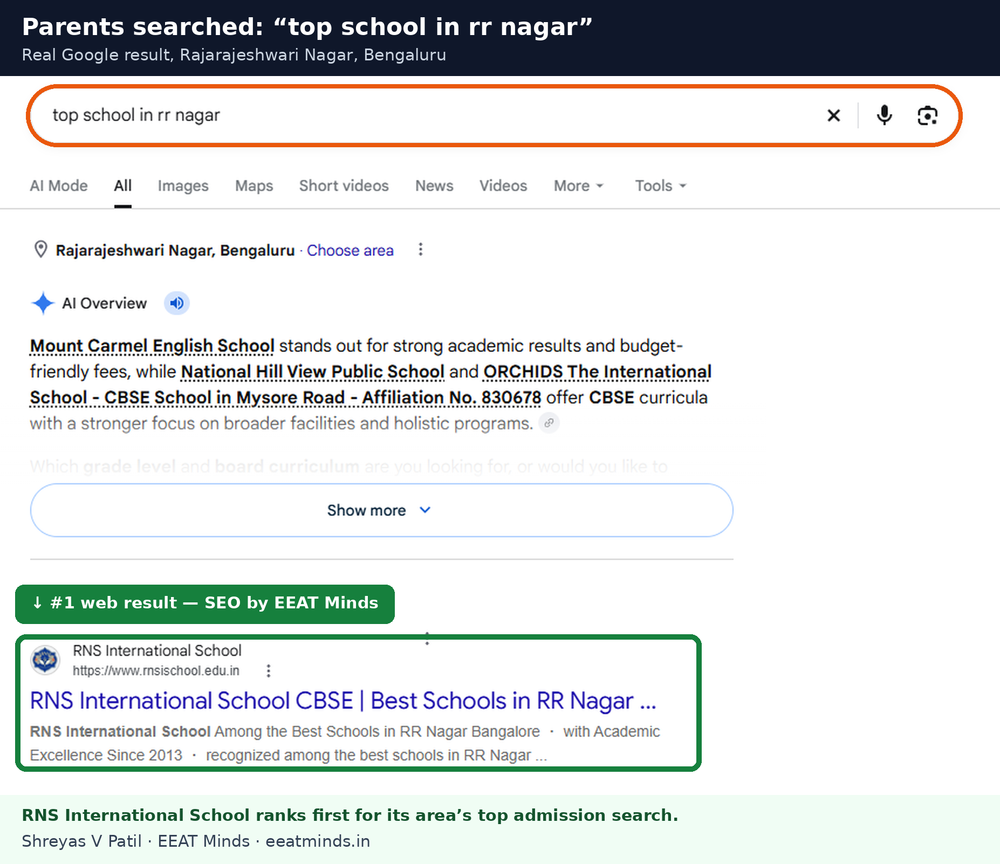

# Case Study Page: RNS International School

Publish this on Wix as a page, for example `eeatminds.in/school-seo-case-study`. Don't link to it in Email 1 (links hurt deliverability). Use the link in LinkedIn DMs, WhatsApp follow-ups and proposals.

**Fill every `[ ]` with real facts before publishing.** Don't publish numbers you can't back up. Ask RNSIS for permission first.

---

## How RNS International School became the #1 Google result for "top school in rr nagar"

*SEO for schools · Rajarajeshwari Nagar, Bengaluru · [month/year]*



### The school
RNS International School is a CBSE school in Rajarajeshwari Nagar, Bengaluru, delivering academic excellence since 2013.

### The challenge
During admission season, parents in RR Nagar shortlist schools on Google. They search phrases like "top school in rr nagar" and "best CBSE school near me". [Describe the starting point: where RNSIS ranked before, e.g. "RNSIS was on page [X]"].

### What we did
- [e.g. Rebuilt the admissions page around what parents actually search for]
- [e.g. Optimised the Google Business Profile for local "school near me" searches]
- [e.g. Added parent-focused content: fees range, transport routes, board, admission dates]
- [e.g. Built local citations and links from Bengaluru education directories]

### The result
- **#1 web result** on Google for "top school in rr nagar"
- [Number of admission enquiries from Google this season, or % change vs last season]
- [Any other result: more calls, more campus visits, more Google reviews]

> "[1–2 line quote from the Principal or Admissions Head]"
> **[Name], [Title], RNS International School**

### Want the same for your school?
I help schools complete their admission goals with parents who find them on Google. Get a **free 2-minute Admission Search Audit** for your school.

**[Button: WhatsApp Shreyas] · [Button: Book a 15-minute call]**

---

### What to ask RNSIS (copy-paste into WhatsApp)

```
Hi [Name], hope admissions are going well! A quick favour: could I mention
RNSIS's Google ranking ("top school in rr nagar") as a case study when I talk
to schools outside RR Nagar? And if you have it handy, roughly how many
admission enquiries came from Google or the website this season? A one-line
quote from you would be amazing too. Thank you!
```
